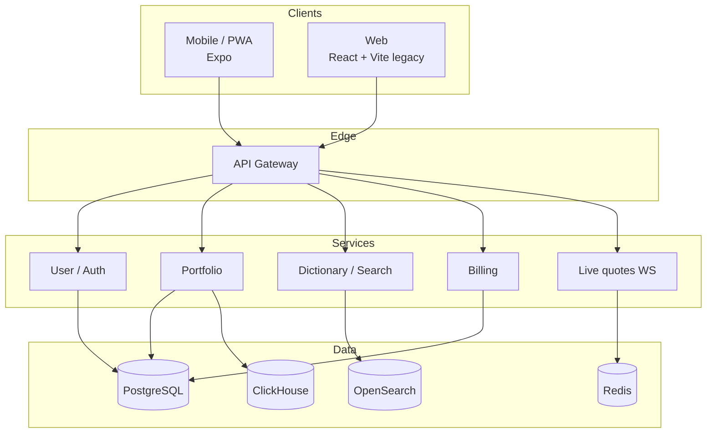

# Архитектура FuncFund (overview)

Высокоуровневая схема. Детали реализации, деплой и внутренние сервисы не раскрываются.

## Публичные контракты

См. `contracts/public/`:

- `user-api.yaml` — регистрация, login, OAuth-провайдеры, профиль
- `portfolio-api.yaml` — портфель, история, импорт, интеграции
- `dictionary-api.yaml` — поиск активов и курсы
- `billing-api.yaml` — тарифы, подписка, checkout

Internal и webhook-эндпоинты в mirror не включены.
